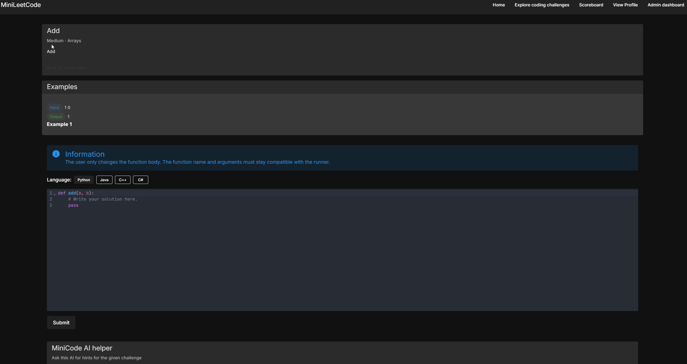

MiniLeetCode is a mini LeetCode-style full-stack application. 
The goal of this project is to create a simple version of a 
coding challenge platform where users can solve programming problems, 
submit different code solutions, and see how other users solved the same problems.

The goal of this project is not to recreate all of LeetCode, but to build a smaller and simpler version while exploring the different parts of a full-stack application, including frontend development, REST APIs, authentication, databases, secure password storage, code execution, and AI integration.

The desired workflow on the features is

Visitor
→ Sign Up
→ Log In
→ Browse Challenges
→ Open Challenge
→ Write Code (C#, Java, Python, C++)
→ Submit Solution
→ Secure Backend Execution
→ Run Test Cases
→ Challenge Solved
→ Update Profile
→ Update Scoreboard
→ View Other Solutions
→ Ask miniHelper for a Hint
→ Admin Manages Challenges

The project will be built using the following technologies:
- Frontend: Vue.js, HTML, Vuetify, Vue Bits and Typescript
- Backend: Spring Boot, Java, Rest APIs, Spring Security, JWT
- Database: PostgreSQL

I made this application with a custom code judge server of my own. The idea is to use Docker to create a virtual environment in which the code execution takes place. To make sure the code runs safely, several build commands are enforced in both the build phase of the container and the running phase of the container.

The process is as follows for the custom code judge:

Frontend code submission
→ Backend receives the code
→ Backend creates a virtual environment based on the container data in the database
→ The environment is created and the code is run
→ A report based on the result is created in the form of a submission
→ Feedback is given back to the user

The application's frontend includes features such as:
- A landing page describing the main goal of the application
- A challenge board in which the user can browse different types of challenges they want to solve
- A playground to solve the challenges using a code editor, where the syntax highlighting adjusts based on the supported languages: Python, C#, Java, and C++
- A user profile section where the user can update their password, email, username, and bio, and also see which submissions they have sent, how many points they have gathered, and how many easy, medium, or hard questions they have solved

The application is also secure: the user can safely log in, a safe session is created, and the user can then navigate the site while no other user can see their private information on the frontend. The application handles the full-stack flow of login, logout and session, and it also includes an email service for resetting a forgotten password, but this does require a mail server.

The application also includes an admin session.
The admin session can view the user statistics based on how many challenges each user has solved, their score, and how many questions they have solved based on difficulty.

The project uses design patterns to make sure it stays open towards the addition of extra features. I have used the strategy and factory patterns from the pattern catalog.

You can run the application by first importing it into your favorite editor; I used IntelliJ.

Also make sure to define your database password, OpenAI API key, etc. in the environment file before starting. The `.env.example` file in the repository shows every variable the application needs: copy it to a `.env` file and fill in your own values.

So, do the following to start the application:

Start the backend
→ Run the Spring Boot main application (or `./mvnw spring-boot:run`)

Start the frontend
→ Navigate to the frontend folder
→ Start the frontend with Vite (`npm install` and `npm run dev`)

The application also expects PostgreSQL and Redis to be running, and Docker for the code execution of the judge.

The frontend then runs on http://localhost:5173 and the backend on http://localhost:8082.

Down below you can see how a user could for example solve a Python challenge by adding two numbers together.

Check it out.

I do plan to expand on this, but this is the first application that I am happy about. There is still much to do.

Right now not everything is fully tested, but there is a set of unit tests that capture much of the application's correctness, and some integration tests are still missing.

The next steps are to give the user more feedback on how many tests have passed, and to add more admin features, such as enabling and disabling users.
The goal is also to ensure a larger test coverage.

Right now there is a release you can grab.

**PLEASE NOTE: THERE MAY BE DRAGONS HIDDEN, OR BUGS I MIGHT NOT HAVE ENCOUNTERED YET**

If you decide to use the application, just be cautious.

